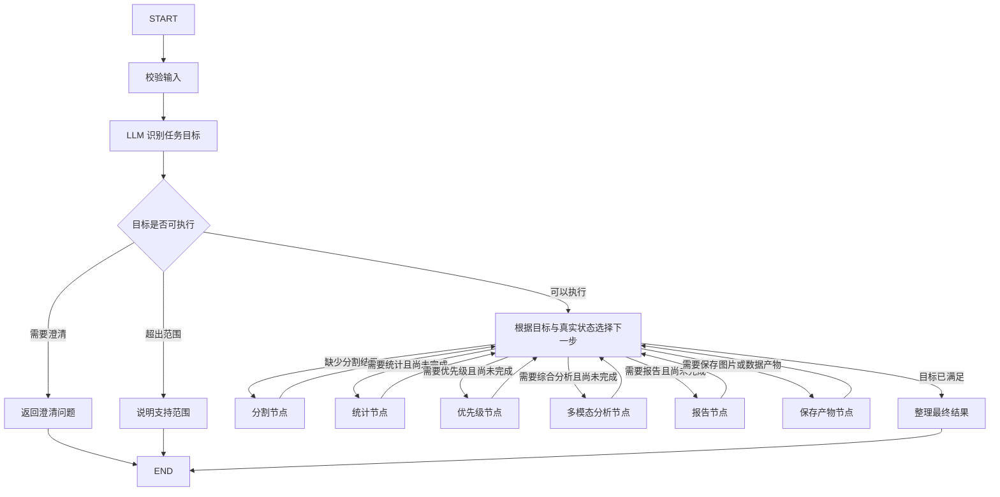

# LangGraph Agent 最终架构方案与实施核对依据

编制日期：2026-10-30。工作分支：`Dynamic-task-routing`。

文档状态：已实施并完成本轮验收；下方记录保留开发核对过程和实际发现的问题。

## 1. 已确认的目标与边界

- 默认执行引擎为 LangGraph，通过 `--engine react` 保留现有 ReAct 引擎。
- LLM 识别用户目标；LangGraph 按校验后的目标、数据依赖和真实完成状态控制执行。
- 按本文第 3 节架构图组织节点和条件路由，不能把整个旧 ReAct 循环包成唯一图节点。
- 支持分割、统计、优先级、完整报告四种深度，以及按需视觉解释和救援建议。
- 继续复用已有分割、统计、优先级工具、公共 LLM 客户端、多模态分析服务和报告渲染能力。
- 单次运行只处理本轮请求。保留批量输入，每张图片独立分析，不跨图汇总或排名。
- 通过 LangGraph 原生流式机制输出执行进度。第一阶段不要求 LLM 正文逐 token 流式输出。
- 统一产物根目录为英文 `output/artifacts/`，每次运行使用独立文件夹；ReAct 也遵守相同归档规范。
- 文件归档为未来历史记录和记忆管理保留依据；当前不实现多轮对话、自动记忆检索、Checkpointer、SQLite、进程恢复或网页。
- 保留原始掩膜的统计口径、共享配色、最近邻掩膜缩放和图片坐标映射，不改动训练算法与优先级公式。
- 新增或修改的关键代码使用中文注释；测试脚本、验收日志和示例产物继续放在用户指定的项目外可写目录。

## 2. 实施时必须遵守的核对流程

每个实际实施步骤开始前，都重新读取本文件第 3 节架构图，并核对本步骤对应的节点、边、状态和产物约定。不能只凭对话记忆推进。

每个步骤完成后：

1. 对照架构图检查实际调用路径与终止条件。
2. 检查是否出现多余节点、虚假数据、过期结果或不符合目标的报告生成。
3. 检查产物是否仍归属于当前 run/item 文件夹，事件是否来自真实执行。
4. 记录本步骤修改、验证结果和剩余事项。
5. 若发现必须改变架构，先说明原因并更新方案；影响已确认行为的变化需先与用户确认。

这是开发过程中的核对要求，不要求应用在每个运行时节点读取 Markdown 文件。

## 3. 核心架构图



图中的 R 是确定性条件路由，不调用 LLM；实现可使用条件边和小型路由函数，不必额外安排一次模型判断。

错误处理为所有节点共用的终止分支：校验或执行失败，保留已完成结果，整理失败信息并归档，再进入 END。节点失败不能沿成功边继续下游。Q/U 同样保存请求、事件和最终状态。

保存产物节点是可重复到达的阶段落盘节点：保存当前已完成阶段尚未落盘的成果，再返回 R。每轮写完后清除对应待保存标记，防止反复进入该节点。报告节点是有文件副作用的节点，复用统一产物管理器指定的路径，不再自选共享输出目录。

最终整理负责完成 run/item 清单、最终回答与状态的写入，不改变已计算结果。若最终落盘失败，业务状态为 failed，不能输出全部成功。

## 4. 双引擎入口与兼容策略

- `agent_cli.py` 增加 `--engine langgraph|react`，默认 langgraph。
- LangGraph 控制器与 ReAct 控制器保持独立，复用业务服务和产物管理器。
- ReAct 保留现有工具选择循环及完整五阶段处理方式；动态目标路由首先属于 LangGraph，不能声称两个引擎的路由行为完全一致。
- 两种引擎统一返回任务状态、正文、产物列表和执行记录，CLI 根据引擎展示各自真实过程。
- LangGraph 只在选择它时导入所需图模块；ReAct 的独立使用不应被图模块的初始化副作用阻断。
- 新引擎不使用 Thought/Action 文本正则驱动节点。旧解析器留在 ReAct 中。
- 输入校验与目标判断先于分割模型加载；模型通过运行时服务延迟加载，批量运行复用实例，各图片状态隔离。
- `--skip-check` 可跳过提示性前置检查，不能绕过节点依赖、数据合法性和目标完成检查。

## 5. 目标识别协议与优先级

LLM 输出经过类型与业务校验的目标对象，不直接返回工具调用参数或任意节点名。

| 字段 | 含义 |
|---|---|
| target | segmentation / statistics / priority / report |
| focus | 关注类别、范围和问题；类别编号限制在现有标签集中 |
| needs_visual_analysis | 是否需要结合三图进行解释 |
| needs_rescue_advice | 是否需要具有依据的行动建议 |
| requested_artifacts | 用户明确要求导出的图片或文件 |
| report_format | html / markdown；无报告需求时为空 |
| status | ready / needs_clarification / unsupported |
| clarification_question | 需要澄清的具体问题 |
| decision_summary | 可公开的简短目标判断依据 |

规则由程序校验并计算依赖闭包：

- statistics 需要 segmentation。
- priority 需要 statistics。
- 视觉统计解释需要 segmentation + statistics，不强制 priority。
- 救援建议需要 segmentation + statistics + priority + multimodal。
- 完整 report 需要 segmentation + statistics + priority + multimodal + report。
- target=segmentation 却要求统计、报告或救援建议，属于目标字段不一致，必须修正识别结果或澄清。
- 默认问题“分析当前灾区图像的损坏情况并生成救援建议”对应 priority + 多模态建议，不自动生成报告。
- 显式 `--output name.html` / `.md` 是报告输出要求；程序自动生成的内部文件名不是用户意图。
- 显式输出扩展名与报告格式冲突、文字“不要报告”与显式报告参数冲突时，返回澄清，不能静默覆盖。
- 未明确报告格式时采用配置默认格式；不支持的格式明确说明限制。
- 目标 JSON 格式错误只允许有限修正，仍无效返回 failed；语义不确定或相互冲突返回 needs_clarification。
- 当前单轮 CLI 返回澄清问题后结束。用户修改问题再次运行，不宣称保存并自动续接对话。

| 示例请求 | 必要执行 | 不执行的阶段 |
|---|---|---|
| 给我分割图/叠加图 | 分割、产物保存、最终整理 | 统计、优先级、综合分析、报告 |
| 只统计各类占比 | 分割、统计、产物保存、最终整理 | 优先级、综合分析、报告 |
| 结合图片解释道路损坏分布 | 分割、统计、解释模式综合分析、产物保存、最终整理 | 优先级、报告 |
| 只计算优先级分数 | 分割、统计、优先级、产物保存、最终整理 | 综合分析、报告 |
| 给出救援建议 | 分割、统计、优先级、救援模式综合分析、产物保存、最终整理 | 报告 |
| 生成完整报告 | 所有必要业务阶段、产物保存、最终整理 | 无 |

“只看道路”限制解释与显示重点，分割网络仍预测全部类别，不能据此虚构局部模型推理或通行能力。

## 6. 状态、运行时依赖与更新约定

| 类别 | 建议状态内容 |
|---|---|
| 输入 | question、image_path、run_id、item_id、显式 CLI 要求 |
| 目标 | 校验后的目标对象、required_stages |
| 结果 | segmentation、statistics、priority、analysis、report |
| 版本 | 当前上游版本或依赖签名，防止复用过期数据 |
| 产物 | 已完成产物引用、待保存项、run_dir、item_dir |
| 执行 | 节点完成状态、次数、耗时、阶段事件 |
| 错误 | failure_stage、错误类型、可重试标记、简短信息 |
| 输出 | status、final_answer、summary、artifact 列表 |

运行时服务管理模型实例、设备和 LLM 客户端，不把这些对象写入业务状态。图节点返回明确的局部更新，不依赖不受控的原地修改。事件采用追加语义，其余单一结果字段覆盖更新；第一阶段按单图顺序执行，不并行写同一字段。

原始掩膜与本次三图可以保存在内存状态，供节点直接读取。大型 logits 不进入目标识别、事件或持久化清单；任务结束后释放不再使用的数据。对外结果使用文件引用和业务摘要，不序列化完整运行时对象。

失效规则：重新分割清除统计及之后结果；重新统计清除优先级及其依赖结果；重新计算优先级清除依赖该数据的分析和报告；重新分析清除报告。同一有效依赖签名的结果可以在本次运行中复用，跨运行不自动命中旧缓存。

## 7. 完成条件与最终状态

| 结果 | 成功条件 |
|---|---|
| 分割 | 原始掩膜有效，用户所需可视化和必要档案已保存 |
| 统计 | 统计与当前原始掩膜、来源图像一致 |
| 优先级 | 评分与当前统计一致 |
| 综合分析 | 所需证据齐备、返回结构完整、分析用途匹配 |
| 报告 | 使用当前综合正文，报告文件成功写入且可读 |
| 整体任务 | 所有 required_stages 满足，必要档案与最终清单写入成功 |

END 仅表示停止执行。最终 status 明确为 completed、needs_clarification、unsupported 或 failed。后面三种不计作成功分析；失败可以保留部分成果，但不声称目标全部完成。

CLI 汇总成功任务数与失败/澄清/不支持数，并单独统计报告数。建议退出码：全部 completed 为 0；有 failed 为 1；仅含澄清/不支持而无 failed 为 2。

## 8. 多模态服务调整

复用 `MultimodalAnalysisService`，增加明确分析用途：

- interpretation：三图 + 图例 + 统计，输出可见现象、空间关系、统计解释、疑点和局限；priority 可缺省，不强制救援建议。
- rescue：三图 + 图例 + 统计 + priority，额外输出行动建议及依据。

保留已有 rescue 默认调用的兼容性，ReAct 工具继续运行完整救援分析。JSON 校验与正文渲染按用途执行，不通过伪造空 priority 对象补齐接口。

真实统计表仍由程序生成。视觉复核不直接改变掩膜、统计和优先级。分割图与报告用同一图例；原图与掩膜映射、传输缩放及最近邻类别缩放继续校验。模型输入的缩放尺寸与报告全尺寸分别记录。

## 9. 文件夹级产物管理

英文根目录使用 `output/artifacts/`。项目已存在该目录，沿用并保留其中原有内容。

一次 CLI 调用对应一个 run 文件夹；每张输入图对应一个 item 文件夹。即使单图也保持同一结构，方便未来网页统一读取。run/item 标识使用时间信息与随机唯一标识，原始文件名只作为可读附加信息；不能仅靠同名文件 stem 防碰撞。

```text
output/
  artifacts/
    <run_id>/
      manifest.json
      request.json
      result.json
      events.jsonl
      items/
        <item_id>/
          manifest.json
          request.json
          result.json
          events.jsonl
          images/
            original.jpg
            segmentation.png
            overlay.png
          data/
            mask.npy
            visualization.json
            statistics.json
            priority.json
            analysis.json
          report/
            <report_name>.html
    legacy_reports/
      <原报告目录中的内容及迁移清单>
```

以上是完整成果示例。只有执行并成功完成的阶段才创建对应业务文件；Markdown 报告使用 `.md`。新报告不再直接写到 `output/reports/`。

分割成功后归档三图、原始类别掩膜和图例/尺寸映射，便于未来复核。统计、优先级、分析完成后独立保存对应 JSON，不依赖是否生成报告。保存这些内部成果不等于执行额外分析，也不等于用户要求了报告。

原图档案是本次实际读取图像的独立可视快照，同时记录输入文件路径及内容哈希；快照若经过 RGB/JPEG 编码，不宣称它与原始输入文件字节一致。报告可继续自包含嵌图，避免移动时丢图；同时登记它依赖的图片和分析引用。

manifest 至少包含 schema_version、run/item 标识、引擎、问题摘要、输入来源与哈希、任务目标、创建/更新时间、状态、失败节点、产物角色、相对路径、内容哈希与来源关系。只保存必要且脱敏的模型/推理配置，不保存密钥、完整 SDK 请求或 API 凭据。路径以文件夹为基准，方便整体移动和网页引用。

生命周期：创建记录 running；每阶段完成后落盘并更新清单；终止时写 completed/failed/needs_clarification/unsupported。进程崩溃可能留下 running，需要未来扫描判断未正常结束，不能将其视作成功或当前已支持自动恢复。

写入采用临时文件 + 原子替换，成功后登记产物；同一阶段重试不追加重复成果。报告渲染写到当前 item/report，由管理器登记。analysis.json 由独立产物层保存，报告工具不再负责唯一的分析归档。

历史目录迁移在实施阶段进行：先清点 `output/reports/` 及引用资源，再整体归档到 `output/artifacts/legacy_reports/`，保留原内部相对结构并记录新旧路径；若目标冲突，不覆盖，选择唯一历史批次子目录。迁移成功并验证后才清理空的旧 reports 目录。既有 `output/artifacts/`、checkpoints 和训练/推理输出不混入新任务或冒充新结构；不搬迁其他无关数据。

未来记忆系统和网页可从 manifest 读取历史，但本期不建立会话关联、事实修正、检索索引或历史列表 API。

## 10. 配置与路径兼容

- `agent.engine` 默认 langgraph，CLI 显式参数优先。
- 新增 `artifacts.output_dir`，默认 `./output/artifacts`。已有多模态配置继续使用。
- 新增 graph/目标识别的输出预算、有限重试及步骤上限配置。
- 报告配置保留 format 和展示设置，输出目录由本次产物上下文决定，不能通过修改共享工具属性在不同 item 之间切换目录。
- 对旧 `report.output_dir` 设置做兼容归一化：旧默认 `./output/reports` 转入新默认；显式自定义目录没有新 artifacts 配置时，继续作为产物根目录，避免破坏外部输出重定向。两者都存在时以 artifacts 配置为准。
- 验收用外部配置的显式目录必须得到遵守，不能悄悄写回项目内。
- `--output` 继续表达报告文件名，不能被解释成任意输出目录。合法路径和文件名由程序处理，LLM 不能指定越界路径。
- 用户文字、显式 CLI 参数与格式要求冲突时返回澄清。

## 11. 流式执行记录

LangGraph 控制器提供 stream 接口，CLI 实际消费 LangGraph 的 custom/updates 事件。custom 用于开始、结束、重试和产物写入等业务事件；updates 仅在内部转换为安全摘要，不原样打印或持久化整个状态。

标准事件字段：schema_version、run_id、item_id、sequence、timestamp、node、event、status、elapsed_seconds、attempt、摘要和产物引用。默认使用机器可解析时间，运行目录命名采用 Asia/Macau 本地日期。

完成时间、节点顺序、错误来自真实执行。decision_summary 是模型生成的公开简述，不标为完整内部思维链。模型 token 逐字流式输出不属于本期验收条件；节点长耗时期间开始事件应及时可见。

ReAct 保留原有 trace 展示，并经适配记录到相同 run/item 归档，不伪装为 LangGraph 事件。

## 12. 错误与重试

- 分类格式错误有限重试，语义冲突走澄清，不退回完整流水线。
- 验证失败不加载模型、不调用下游。
- 网络和结构重试统一计数，考虑 SDK 自带重试，避免 SDK × 服务 × 图层重复放大。
- 分析失败保留分割和统计，报告失败保留分析；最后失败原因和可用产物明确列出。
- 保存文件有副作用，使用稳定路径和原子提交；不能因为图重试产生多份标称成功报告。
- 缺失依赖、失败状态、版本不一致不能通过“对象非空”判定成功。
- 不添加自动重分割、自主切换模型、无上限自我反思循环。

## 13. 文件修改清单

| 文件 | 动作与职责 |
|---|---|
| LANGGRAPH_ARCHITECTURE.md | 本文件；架构图、约束和实施检查记录 |
| modules/agent/task_schema.py | 新增：任务协议、枚举、合法性和依赖闭包 |
| modules/agent/intent_router.py | 新增：调用公共客户端识别目标，处理格式修正和澄清 |
| modules/agent/graph_state.py | 新增：状态字段、事件追加和结果覆盖约定 |
| modules/agent/runtime_services.py | 新增：延迟加载及复用模型、客户端与业务工具，隔离运行时依赖 |
| modules/agent/graph_nodes.py | 新增：校验、分类、业务执行、保存、终态整理节点 |
| modules/agent/graph_controller.py | 新增：按第 3 节组图、条件路由、compile、run/stream 适配 |
| modules/agent/artifact_store.py | 新增：run/item 目录、独立成果、manifest、原子写入与引用 |
| modules/agent/execution_events.py | 新增：事件协议、摘要脱敏及两种引擎的输出适配 |
| modules/agent/multimodal_analysis.py | 修改：支持 interpretation/rescue，优先级按用途可选 |
| modules/agent/tools/multimodal_tool.py | 必要兼容调整，ReAct 默认仍运行 rescue |
| modules/agent/tools/report_tool.py | 修改：接收当前产物目录/上下文，只渲染报告，独立管理器保存分析 |
| modules/agent/react_controller.py | 修改：保持旧调度，适配本次产物上下文和统一结果/事件 |
| modules/agent/__init__.py、modules/agent/tools/__init__.py | 修改：导出接口并避免重型/图依赖的无条件初始化 |
| agent_cli.py | 修改：默认 LangGraph、--engine、流式消费、显式输出要求、批量状态及汇总 |
| configs/config_loader.py、configs/agent_config.py | 修改：新配置默认值、旧输出目录兼容、配置导出 |
| config.yaml.example | 修改：默认引擎、artifacts、graph/目标识别配置与中文说明 |
| config.yaml | 如现有旧目录配置需要迁移，仅定点改引擎/产物设置，保留密钥和已有模型配置 |
| requirements.txt | 修改：声明经过验证的 LangGraph 及直接使用的相关依赖范围 |
| README.md、QUICKSTART_AGENT.md | 修改：双引擎用法、动态任务路径、流式事件和产物目录 |
| output/reports/ | 实施时验证后迁入英文 artifacts 历史目录，不在设计阶段移动 |

现有分割、统计、优先级工具和可视化算法优先复用，不为迁移无关重写；如确需增加可选事件回调，仅做兼容扩展。LLMClient 继续作为模型调用基础，不要求改用 LangChain 模型封装。训练、评估和数据集代码不在本次改造范围。

## 14. 实施顺序与验收

每步开始均重读第 3 节并执行第 2 节核对。

1. 完成目标/状态/事件协议与独立产物管理，验证同名输入隔离、路径兼容、清单状态和原子写入。
2. 接入目标识别，覆盖四种深度、两种分析用途、显式输出参数、否定报告、冲突、澄清与不支持。
3. 调整多模态服务用途及报告上下文，保持原完整救援流程回归通过。
4. 按图构建 LangGraph 和真实依赖路由，验证必要节点执行且多余节点不执行。
5. 接入 CLI 默认引擎与原生流式消费；ReAct 接入相同文件夹级产物规范，保留调度行为。
6. 清点并迁移旧 reports，更新默认配置和文档，验证历史文件及引用未损坏。
7. 使用实际 agent_cli.py 做双引擎验证、不同任务路径和失败路径验收；外部配置保存测试产物，最后审核文件差异。

必要测试：目标结构、依赖闭包、图终止、无多余节点、原始掩膜统计不变、多模态用途、同一结论复用、失败保留上游、重试上限、结果失效、同名与批量隔离、manifest 可移动引用、流事件及时且脱敏、默认 LangGraph、ReAct 显式可用、退出码及输出根目录兼容。

先做受控 API 边界测试，再用现有 GPT 实际运行代表性路径，明确区分本地测试通过和服务端端到端成功。不承诺跨运行缓存、断点恢复或完整多轮记忆。

## 15. 当前进度

- [x] 整理用户反馈，核对当前分支与模块接口。
- [x] 在项目根目录保存本方案及指定架构图。
- [x] 用户审阅本文，确认进入实现。
- [x] 按第 14 节推进业务实现与验收。

### 实施核对记录

- 步骤 1/2：实施前已重读第 3 节；已加入任务协议、依赖闭包、版本状态、脱敏事件、原子产物归档和有限重试目标识别。外部契约测试已验证依赖/非法目标/唯一目录/哈希损坏检测；完整模块导出待图接入后一并通过。
- 步骤 3：实施前重读第 3/8/9 节；多模态 interpretation/rescue 与报告单次目录已接入。外部新模式测试、旧多模态 16 项及原单图报告 2 项已通过，尚待图内及真实 API 验证。
- 步骤 4：实施前重读第 3 节；使用实际 StateGraph 多节点/条件边，保存节点每阶段返回路由；校验与澄清路径已运行通过，其余正在受控模型边界测试中。
- 实施发现：顶层 modules/__init__.py 原先无条件导入训练、评估、绘图，导致分类前仍加载重型依赖。保留原导出的延迟加载方式修复，训练算法不变。
- 步骤 4/5：外部图运行 5 项、协议归档 4 项、目标/实际 CLI 4 项均通过。CLI 默认图引擎已接入原生流；旧 ReAct 保留调度并逐阶段归档。独立复核发现 ReAct 上游重算后的磁盘失效遗漏及语义冲突终态问题，已先复现再修复，回归 2 项通过。
- 步骤 6：实施前重读第 3 节。清点旧报告 3 份共 16,965,668 字节，均为自包含图像、无外部资源引用；整体迁入 output/artifacts/legacy_reports，逐文件哈希一致并保存迁移清单。未搬动已有 artifacts、checkpoints 或训练输出。配置兼容、依赖范围及使用文档已更新。
- 步骤 7：真实 CLI 已完成 10807 分割、10794 统计、10836 三图解释；正在执行其余救援/报告/双引擎及批量验收，最终结果以外部验收报告为准。
- 再审发现运行级 result 成功写入但最终 manifest 写入失败时，可能留下不一致状态；外部故障注入已复现。已在运行终态提交错误时尽力将 result/manifest 一起标记 failed，保留已完成 item；永久存储故障仍以退出码 1 告知，不能承诺磁盘不可写时一定写入失败档案。
- 普通 Windows 启动附加验收：移除测试用 MKL 设置后，实际 CLI 在第一次推理发生 Intel OpenMP 重复初始化，进程直接退出，留下 running 档案（符合本期不承诺进程恢复的边界）。已在 CLI 加载数值库前缺省设置 MKL_THREADING_LAYER=SEQUENTIAL，保留用户显式覆盖；不启用 KMP_DUPLICATE_LIB_OK。正在以完全相同的普通入口重新验收。

### 最终验收记录

- 实际 StateGraph 及 CLI 的分割、统计、优先级、interpretation、rescue、完整报告、显式 ReAct、批量、冲突澄清和不支持路径均完成验证。
- 普通入口修复后重跑完成（23.303 秒、退出码 0），无需外部脚本设置 MKL；修复前崩溃日志及 running 档案保留，不隐藏失败。
- 总计 12 次真实 CLI 启动记录、13 个 item，涉及 8 张不同 test 图片；10 个分析 completed、1 个 needs_clarification、1 个 unsupported，另有上述修复前原生崩溃。共 4 份实际 HTML 报告。
- 56 项自动化测试通过（原有 8 项及外部新增/回归 48 项）。实际结果的哈希、路径、原始掩膜统计、三图尺寸、分析来源、节点顺序、事件脱敏与终态均已核验。
- 批量中三个模型各加载一次，图片状态独立；10801 两次运行掩膜一致，10807 两次成功运行掩膜亦一致。
- 所有验收脚本、运行日志、配置副本和示例产物在项目外目录：C:\Users\Danie\.codex\visualizations\2026\10\29\01a186de-168c-7e21-8b44-2de3fa201745。详细结果见该目录 VALIDATION_REPORT.md 与 validation_gallery.html。
- 当前仍有分割边界粗糙、部分类别混淆、固定像素阈值评分局限及 torchvision 弃用提示；本次未修改训练算法或权重。小规模路径验收不等于大规模长期稳定性证明。
