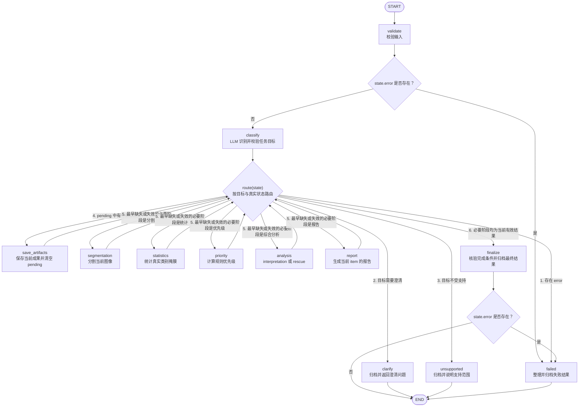
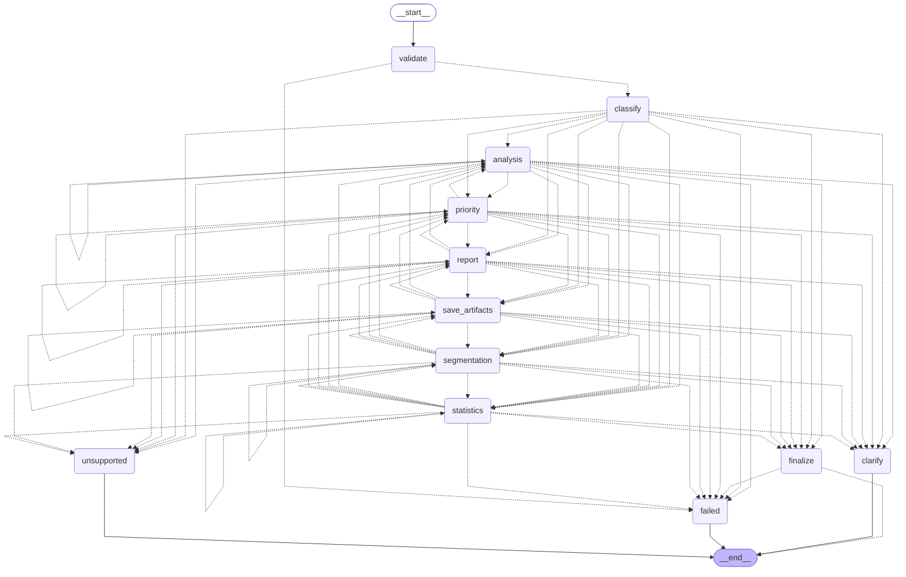

# 当前 LangGraph 执行图

本图依据当前 `modules/agent/graph_controller.py` 的 `StateGraph` 编排，以及 `modules/agent/graph_nodes.py` 的 `route(state)` 条件判断生成。它描述当前实现，原始设计与实施记录另见 [LANGGRAPH_ARCHITECTURE.md](LANGGRAPH_ARCHITECTURE.md)。

## 便于阅读的执行图

下面将多个节点共用的条件边函数合并为一个菱形。**`route(state)`、输入错误判断和最终错误判断都是条件边逻辑，不是通过 `add_node()` 注册的执行节点。**



## 路由规则与执行含义

`classify`、五个业务节点及 `save_artifacts` 完成后，都会通过条件边调用同一个 `route(state)`。函数依次判断：

1. 存在错误：进入 `failed`，不继续执行业务节点。
2. 目标需要澄清：进入 `clarify`。
3. 目标超出支持范围：进入 `unsupported`。
4. 有待保存成果：先进入 `save_artifacts`。
5. 按 `required_stages` 顺序，选择第一个缺失或已经失效的阶段。
6. 全部必要阶段均为当前有效结果：进入 `finalize`。

`is_current()` 会检查结果是否存在、阶段是否完成、结果的依赖签名是否与当前上游版本一致。`finalize` 还会核验必要结果、文件与内容哈希，核验失败则进入 `failed`。

例如，统计任务的正常路径是：

```text
START → validate → classify
      → segmentation → save_artifacts
      → statistics → save_artifacts
      → finalize → END
```

完整报告的正常路径是：

```text
START → validate → classify
      → segmentation → save_artifacts
      → statistics → save_artifacts
      → priority → save_artifacts
      → analysis → save_artifacts
      → report → save_artifacts
      → finalize → END
```

这里省略了每次执行的条件边判断。`analysis` 的用途由目标决定：视觉解释使用 `interpretation`；救援建议及完整报告使用 `rescue`。各阶段只在本次目标要求且当前结果缺失或失效时执行。

## 从编译后 StateGraph 直接导出的 Mermaid

下面通过 `LangGraphController(None, None).graph.get_graph().draw_mermaid()` 导出。构造时只注册节点并编译图，不执行节点、不加载分割模型、不调用 LLM、不创建运行产物。

控制器为共用 `route` 的节点声明了全部候选目的地，因此原生图会画出较多虚线条件边。它们表示候选跳转范围，实际执行仍由上面的条件优先级和真实状态决定；不会每次遍历所有候选节点。



## 图之外的异常兜底

`stream()` 外层另有 Python 异常处理，负责图步骤上限、事件写入等图运行异常，尽力保存失败结果。它不通过 `add_node()` 注册，因此不画成上述 StateGraph 中的节点。原生库直接终止进程时，Python 可能无法写入最终状态，当前实现不承诺自动恢复。
