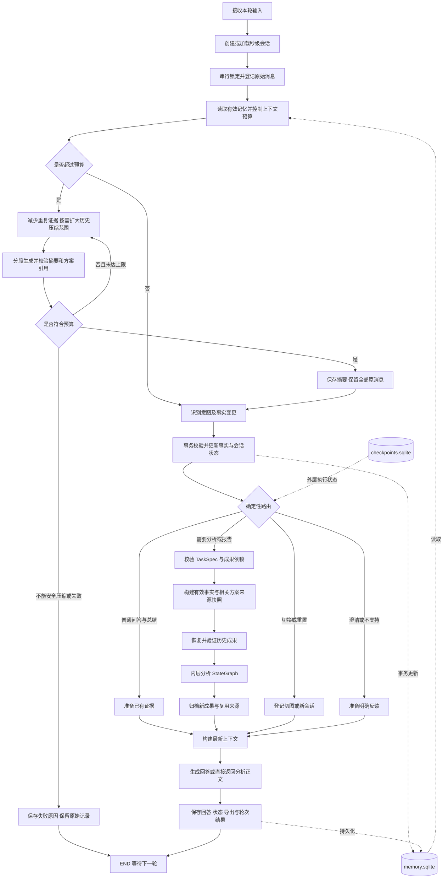
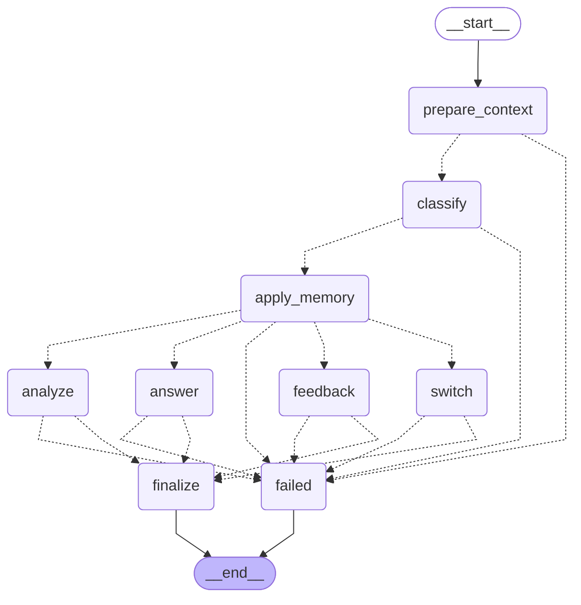

# 多轮对话架构与实施核对依据

状态：已实施并完成代表性多轮验收；当前实现已合入 `main`。

## 1. 契约与边界

- 外层会话 StateGraph 管理对话；内层现有分析 StateGraph 执行真实计算。默认 LangGraph，保留单轮 ReAct。
- CLI 默认进入多轮交互；`--chat` 保留兼容但可省略；单轮/批量显式使用 `--single-turn`，ReAct 使用 `--single-turn --engine react`。单轮参数不能与会话恢复或列表参数混用。
- 根目录 `message/<YYYYMMDD_HHMMSS>/` 是一个会话的完整归档单元；时区 Asia/Macau。原子创建占位，同秒冲突等待下一秒，绝不覆盖或添加随机后缀。
- 退出交互只暂停会话；恢复同一 ID 继续编号；重置创建新会话并保留旧档案。
- `memory.sqlite` 是业务记忆权威来源；messages.jsonl、facts.json、summaries.json、session.json 为可重建导出。原始消息不因压缩而删除。
- 事实记录来源、消息、图片/区域、时间、核实状态；更正以 superseded → active 替代关系保存；歧义先澄清，事务回滚。
- 文本上下文超过 8000 token 后自动压缩，默认目标 6000；最近 4 轮是优先保留范围，必要时扩大压缩范围，始终保留本轮输入、有效事实、方案来源与待澄清事项。长消息分段整理，失败不得覆盖有效摘要或删除原消息。
- 原始输入副本、每轮记录、图检查点和所有新分析产物均在当前会话内；历史完成轮次不可被后续失效处理删除。
- 现有 output/artifacts 保留单轮/批量历史；会话产物保存到 message/<session_id>/turns/；训练输出保留原用途。
- 外层状态只存标量、结构化记忆和文件引用；模型、数组、Base64 不持久化到检查点。
- 首期支持单张当前图片、显式切图、恢复会话；同会话串行执行。不实现网页、跨图排名或内层节点精确断点续跑。
- 保留空间映射、最近邻类别掩膜缩放、共享图例、原始掩膜统计；现场事实仅影响解释/建议，不修改像素或规则评分。
- 新增关键逻辑用中文注释；测试脚本、日志、验收会话放项目外。

## 2. 每步核对规则

每个实施步骤前重新读取本文件第 3 节和 LANGGRAPH_ARCHITECTURE.md 第 3 节。结束后记录修改、验证和偏差。应用运行时不读取架构文档。

## 3. 会话架构图



所有节点通过统一失败分支保存失败轮次；分析失败不得生成成功报告。外层事件和内层事件均标注 session_id/turn_id。本轮 END 不关闭会话。

预算控制仍属于外层 `prepare_context` 服务内部流程，通过 custom 流输出 compression_start/compression_retry/compression_end，未把外层图或内层分析包成单一模型循环。接口明确返回上下文超限时，意图与回答节点最多追加一次更强压缩。8000 是应用压缩阈值，不代表服务商窗口大小；无可用本地编码器时标注 UTF-8 字节保守估算。

## 4. 目录与数据

```text
message/<session_id>/
  session.json
  memory.sqlite
  checkpoints.sqlite
  messages.jsonl
  facts.json
  summaries.json
  inputs/image_0001/{original.<ext>,metadata.json}
  turns/000001/{request.json,result.json,events.jsonl}
  turns/000001/artifacts/<run_id>/items/<item_id>/{images,data,report}/
```

纯聊天轮次不创建分析 artifacts。复用阶段复制或重建到本轮任务目录，并记录原始轮次/产物哈希，保证新报告不依赖被清理的外部路径。报告保存有效事实快照和会话版本；已经完成的历史报告不改写。

历史摘要新增 plans（方案内容、原助手消息 ID、图片 ID），兼容旧摘要的空默认值。报告 `related_plan` 标记为助手建议，与 active_facts 和用户明确决定分开；最新有效事实优先。相同覆盖边界进一步压缩时，在摘要行中保留 revisions，原始消息和失败轮次不改写。

## 5. 执行与恢复

- 意图为 ask_question / provide_information / correct_information / change_focus / request_summary / generate_report / reset_session / switch_image；一句可包含事实更正和报告请求，先更正后报告。
- 普通问答读取已有可验证证据；需要新计算则附带受校验 TaskSpec 进入内层；内层不重复调用目标分类器。
- 分割签名包含原图、预处理、权重配置；统计依赖掩膜；评分依赖统计和权重；分析还依赖问题/关注重点/分析模式/有效事实；报告每次请求生成新的快照。
- 外层 Checkpointer 使用 thread_id=session_id；业务事实以 memory.sqlite 为准。新轮次重置临时字段；中断轮次标记 interrupted，可重试已落盘阶段，不宣称精确恢复内层节点。
- 消息、事实应用和最终回答通过 turn_id 保证幂等；文件与数据库不能共同原子提交，恢复时从数据库重建导出。
- 串行锁使用进程退出可释放的操作系统锁，不以永久锁文件的存在判断忙碌。

## 6. 实施计划与进度

使用 writing-plans / executing-plans / test-driven-development；独立模块使用 subagent-driven-development。用户指定共享分支内实施，测试目录在项目外，不创建额外 worktree，不自动提交。

| 步骤 | 产物与验证 | 状态 |
|---|---|---|
| 1 | 会话存储：秒级 ID、图片、消息、事实替代、恢复、导出与锁；12项外部存储测试 | 完成 |
| 2 | 类型协议、意图、上下文和压缩；15项外部对话测试 | 完成 |
| 3 | 内层阶段恢复、递归父签名、快照与报告上下文；复用和历史隔离测试 | 完成 |
| 4 | 外层 StateGraph、检查点、事件与错误归档；多轮及恢复测试 | 完成 |
| 5 | 终端入口、配置、文档；实际CLI 3次启动/同会话6轮/2张图，以及单轮回归 | 完成 |

接口核对：步骤 1 提供 SessionStore；步骤 2 的 DialoguePlan/ContextManager 不依赖存储实现；步骤 3 提供 AnalysisBridge.run_stream；步骤 4 组合前三者；步骤 5 仅通过会话控制器调用。共享图像服务在进程内复用，不进入数据库。

## 7. 验收与修复记录

- 新增外部测试37项通过；原项目8项回归通过；6个独立审查回归探针通过。所有测试脚本、日志、会话及报告位于项目外 `multiturn_validation` 目录。
- 实际入口为 `agent_cli.py`，使用现有权重和已配置的大模型：10794.jpg统计 → 保存8人/2车 → 退出 → 恢复并更正12人/生成HTML → 总结 → 再退出恢复 → 切10782.jpg → 只分割。6轮均 completed，12条原始消息，42条外层检查点。
- 报告阶段实际复用分割与统计，只补算优先级、分析与报告；切图后只执行用户所需分割阶段。逐项核验文件哈希、掩膜统计和会话目录边界。
- 修复内层继承检查点导致NumPy序列化：内层显式 `checkpointer=False`。
- 修复跨轮父版本号碰撞：阶段上下文包含真实父签名，评分配置变化会使旧分析失效。
- 修复回答已入库后导出/末尾事件失败造成终态冲突：重建导出并读取权威记录；持续失败持久化归档错误。
- 本地 `/new`、`/image` 绕过旧历史压缩；缺少或损坏BPE缓存不隐式联网阻塞终端。
- 未完成请求绑定原文、附件路径/哈希和可信本地操作，拒绝不同载荷重放；取得会话锁后才重置运行时状态。
- 分析正文不能声明程序是否保存报告文件，发现这种输出时有限修正；报告状态由程序判定。
- 代表性真实多轮不等于大规模稳定性保证。长历史压缩、失败及并发分支通过受控边界测试；本次真实6轮未触发长历史压缩。

### 2026-10-31 上下文自动压缩与报告续接修正

- 修复最近4轮固定保护导致第四轮无历史可压缩：改为优先保留，按预算扩大压缩范围，至少保留本轮完整请求。默认触发8000、目标6000，长消息分段合并，摘要和覆盖边界校验后才提交。
- 分开模型输出token上限与UTF-8保守字节估算；真实摘要约2100字节时不能误以为超过1800模型token。按整个上下文剩余空间控制摘要，并保留最终总长度检查。
- 摘要新增方案及消息/图片引用；报告携带相关方案和本轮已确定的格式、范围，历史“先不生成报告”不再进入报告要求。助手建议与用户决定、现场事实分开。
- 在原会话20261031_165539上通过真实agent_cli.py及现有大模型续接：第7轮11355→5803并生成初版；审读修正历史要求进入正文的问题后，第8轮13046→5513，保留近期1轮，生成最终HTML，退出码0，108.93秒。两个数字均为明确标注的UTF-8字节保守估算，而非精确token或模型窗口大小。
- 第4轮原失败记录保留。第5轮为沙箱网络失败，第6轮暴露摘要长度单位误判，均保留审计；第7、8轮完成报告。没有回写历史轮次。
- 最终54项外部回归与原项目8项回归通过；审计原8条消息及前4轮46个文件不变，原现场事实不变，11项产物哈希有效；新增一条本轮生成报告的用户决定，不代表确认执行具体救援部署。第8轮复用分割、统计、优先级，综合分析读取三图。
- 测试脚本、日志、原会话备份、验收JSON与正文提取位于项目外multiturn_validation/context_recovery；最终报告归档在本会话turns/000008/artifacts中。

## 8. 当前外层图的原生导出

下面由当前 StateGraph 的 `get_graph().draw_mermaid()` 生成。仅编译导出，不调用模型。内层图见 LANGGRAPH_WORKFLOW.md。


