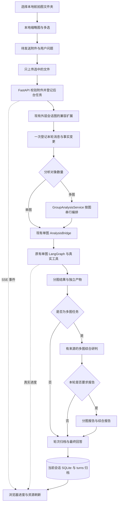

# RescueNet 灾情分析可视化界面开发方案

> **For agentic workers:** REQUIRED SUB-SKILL: Use superpowers:executing-plans to implement this plan task-by-task. Steps use checkbox (`- [ ]`) syntax for tracking. 默认在当前会话逐项执行；未经用户明确要求，不派发子智能体。

**Goal:** 为现有灾情分析 Agent 增加 FastAPI + HTML/CSS/JavaScript 可视化界面，支持本地航拍图集、历史会话、多图共同分析、资源预览及配置管理，保留现有单图计算和 CLI 行为。

**Architecture:** 浏览器负责本地图集与三栏交互；FastAPI 提供会话、附件、后台任务、事件、资源和设置接口。网页通过现有外层 ConversationController 调用内层单图 LangGraph；多图能力在外层扩展，每图独立执行既有计算，再生成带来源的综合研判和报告。

**Tech Stack:** Python、FastAPI、Uvicorn、SQLite、LangGraph、原生 HTML/CSS/JavaScript ES modules、SSE、现有 Jinja2 报告能力。首版不引入 React/Vue、前端构建链或新的 Agent 框架。

**Spec:** 本文件第 1—12 节为已确认需求及具体设计；第 13—16 节为执行计划、验收及核对规则。同时阅读 [LANGGRAPH_ARCHITECTURE.md](LANGGRAPH_ARCHITECTURE.md) 和 [MULTITURN_ARCHITECTURE.md](MULTITURN_ARCHITECTURE.md)。

编制日期：2026-11-02。状态：**首版已实现，核心功能与真实流程验收完成**。执行记录和保留的失败轮次见第 16 节；未逐条复核的原计划细项保持未勾选。

## Global Constraints

- 产品定位是“灾情航拍图像分析与应急研判”，页面围绕选图、分析、现场信息、成果组织。
- 左侧：历史会话 + 本地灾情航拍图集 + 设置；中间：对话；右侧：当前会话资源。
- 图集先在浏览器本地展示；只有用户发送的选中图片上传到 FastAPI，不预先上传整个文件夹。
- 支持一条消息附带多张图片，共同研判；不能用多条伪造用户消息模拟一轮多图任务。
- 会话显示名称固定为新建时间，格式 `YYYY-MM-DD HH:mm:ss`，时区 `Asia/Macau`；底层沿用 `YYYYMMDD_HHMMSS` 会话 ID。
- 单图报告保留图片名；多图报告保留图片名，数量多时采用短名称；每次生成保留历史版本。
- 原有分割算法、集成选择、统计口径、优先级公式、类别配色及空间对齐不变。
- 默认 LangGraph，保留现有单轮 ReAct 和 CLI；网页多轮界面不提供会改变现有语义的引擎切换。
- `memory.sqlite` 是业务记忆权威来源；JSON/JSONL 是可重建导出，不建立另一套网页聊天记忆。
- 历史压缩阈值保持 `8000`，默认目标 `6000`；保留原始消息、事实替代关系和方案来源。
- 配置设置写入实际生效的 YAML 文件，首版保存后重启后端生效；不实现热重载。
- 会话输入与成果保存在 `message/<session_id>/`；既有单轮产物仍在 `output/artifacts/`。
- 新增、修改关键代码补充中文注释，保留原有合理注释，不进行无关重构。
- 实施时先读取本文件及两份架构文档的第 3 节，完成一项核对一项，不能跳过真实运行验收。
- 用户已授权按本方案开发，在当前工作区执行；不自动提交、发布或部署，不修改实际配置。

## 1. 已确认需求和项目现状

### 1.1 需求确认记录

| 编号 | 用户已确认要求 | 落地位置 |
|---|---|---|
| R01 | FastAPI 后端，HTML/CSS/JS 前端 | 第 3、11、13 节 |
| R02 | 简约、学习 Codex 三栏布局，符合灾情业务 | 第 2 节 |
| R03 | 历史记录对应 message 会话目录 | 第 4、8 节 |
| R04 | 左侧有可选本地文件夹的灾情航拍图集 | 第 5 节 |
| R05 | 缩略图本地生成，发送时才上传选中图片 | 第 5、11 节 |
| R06 | 支持多张图片共同分析 | 第 6、8、9 节 |
| R07 | 会话使用新建时间命名 | 第 4 节 |
| R08 | 单图报告对应图片名，多图较多时短名称 | 第 7 节 |
| R09 | 右侧查看当前会话图像、报告和数据 | 第 10 节 |
| R10 | 设置与 config.yaml 打通 | 第 12 节 |
| R11 | 保持既有分析功能，只做必要适配和已确认多图扩展 | 第 1.3、3、14 节 |
| R12 | 方案放项目根目录，实施时反复核对 | 第 15、16 节 |

### 1.2 当前代码核对结果

| 文件 | 当前职责及可复用能力 |
|---|---|
| `agent_cli.py` | 默认多轮入口；单轮批量按图循环；已有 build_report_filename |
| `modules/conversation/cli.py` | CLI 与会话执行分离，可作为网页适配行为参考 |
| `modules/conversation/store.py` | SessionStore、SQLite、原始消息、图片、事实、摘要、分析记录、锁和导出 |
| `modules/conversation/controller.py` | 外层会话 StateGraph，stream、last_result、单轮归档与 request_id |
| `modules/conversation/schema.py` | DialoguePlan、FactChange、HistorySummary、DiscussedPlan |
| `modules/conversation/dialogue.py` | 意图、事实解析、上下文预算、历史方案续接；现有逻辑依赖单图范围 |
| `modules/conversation/analysis_bridge.py` | 单图内层图桥接、历史结果校验复用、会话内成果归档 |
| `modules/agent/graph_controller.py` | 内层单图 LangGraph 和执行事件 |
| `modules/agent/runtime_services.py` | 延迟加载并复用客户端、模型和工具 |
| `modules/agent/artifact_store.py` | run/item 目录、产物角色、哈希和清单 |
| `modules/agent/tools/report_tool.py` | 单图 HTML/Markdown 报告，接受 output_filename；不支持实际 PDF 输出 |
| `configs/config_loader.py` | YAML、RERA_CONFIG、默认值、模块导入时加载 |

### 1.3 本次新增范围与旧文档的关系

当前多轮模式只有一张“当前图片”；CLI 批量模式是多图独立执行，没有跨图综合研判。本方案已获用户确认的多图功能，需要**适度扩展外层会话数据和任务编排**，不是只增加前端多选框。

旧架构文档中“不实现网页”“只支持单张当前图片”“不跨图汇总”描述的是旧实施范围。本方案仅在网页、多图对象关联、综合研判与综合报告这几个已确认范围覆盖旧限制；原始掩膜、规则评分、归档隔离、事实来源等约束继续生效。

未纳入首版：图像拼接、地图/GIS、地理去重、跨图统一规则排名、自动调度救援队伍、账号体系、云端图床、RAG、逐 token 回答、运行中强制取消、会话批量删除和 PDF 导出。不能在界面出现尚无后端实现的功能按钮。

## 2. 页面布局与业务风格

### 2.1 三栏布局

| 左栏：约 280px，可调整 | 中栏：自适应，主阅读区 | 右栏：约 320px，可收起 |
|---|---|---|
| RescueNet 灾情分析、折叠按钮 | 新建时间名称、分析图片范围 | 会话资源、筛选 |
| 新建分析会话 | 消息与图片附件 | 图片 / 报告 / 数据 |
| 历史会话搜索与时间列表 | 真实执行进度、回答 | 按轮次、图片或多图组展示 |
| 可折叠灾情航拍图集 | 底部固定输入区 | 放大、预览、下载 |
| 底部设置按钮 | 附件预览、多选数量、发送 | 无资源时简洁空状态 |

- 浅色默认，白色主区、浅灰侧栏、细分隔线、低饱和蓝色强调。
- 少阴影、少装饰卡片；用户消息浅灰块，助手正文以易读 Markdown 展示。
- 左栏历史区和图集区可调高度，各自滚动；设置始终可见。
- 宽屏三栏；中等宽度右栏抽屉；窄屏侧栏抽屉，聊天和发送入口不被挤出。
- 各栏独立滚动；新消息到达时只有用户已在底部才自动滚到底部，否则显示新消息入口。
- 按钮使用灾情业务词汇：新建分析会话、选择航拍图文件夹、添加到对话、会话资源。
- 空会话说明“选择航拍图，描述分析需求；也可以先补充现场信息”，避免仪表盘和虚构示例指标。

### 2.2 展示状态

必须区分：浏览器选中图片、待发送附件、已提交的分析图片组、正在执行任务、历史资源。选图不改变会话；发送后才登记本轮分析对象。

运行状态显示：排队、处理中、需澄清、完成、部分完成、失败、中断。UI 的“部分完成”是展示层汇总，不直接新增到现有 finish_turn 接受的状态枚举。

## 3. 系统接入架构



FastAPI 直接调用 Python 服务，不启动 CLI 子进程解析 print，不复制 Agent 流程。主数值计算仍在原有内层图，外层负责多图编排和综合结论。

首版使用单 Uvicorn worker、进程内单个分析工作队列，跨会话的重计算任务也先串行调度，避免共享 RuntimeServices 并发访问与多模型显存竞争。既有会话操作锁继续生效；不能跨请求共享同一个有临时状态的 ConversationController 实例。

新启动入口在导入 NumPy/PyTorch 等库之前沿用 agent_cli.py 的 MKL_THREADING_LAYER 兼容处理，尊重用户已有环境变量；不使用 KMP_DUPLICATE_LIB_OK。

## 4. 会话列表、命名和恢复

1. 一个合法 `message/<session_id>/` 会话对应左侧一条记录，沿用 SessionStore 的合法性检查。
2. 标题从 created_at 转为 Asia/Macau 的 `YYYY-MM-DD HH:mm:ss`，不以首条问题、图片名或 LLM 标题替代。
3. 辅助信息可显示轮次数、图片数量、忙碌状态；按创建时间倒序分组，不因继续聊天改变名称。
4. 点击历史记录同时恢复完整原始消息、附件范围、当前分析对象、后台任务和资源。
5. 点击新建，调用现有秒级创建逻辑；同秒碰撞沿用原规则，不覆盖或加随机会话后缀。
6. 新建或切换会话清空待发送草稿附件与勾选；本地文件夹图集可以保留，但不自动发送。
7. 刷新后恢复服务器已提交内容；浏览器本地图集需要重新选择文件夹，不能承诺持久读取本地目录。
8. 历史压缩不删除原始消息，前端不能只展示摘要。消息较多时 API 分页返回原始记录。

## 5. 浏览器本地灾情航拍图集

### 5.1 文件夹与缩略图

- 使用浏览器目录选择能力（webkitdirectory），以 FileList 和相对路径建立本地图集；首版优先验证 Windows Chrome/Edge。
- 递归收集所选文件夹中 JPG/JPEG/PNG/BMP，显示文件夹名、图片数量、相对路径；格式能力与现有入口保持一致。
- 双列缩略图、文件名搜索、稳定自然排序；同名文件用相对子目录区分。
- 通过 object URL、本地解码和缩略图懒加载控制资源占用，滚动离开或切换目录时释放不再使用的对象 URL。
- 选择文件夹、搜索、浏览缩略图均不向服务器发送原图、缩略图或完整文件清单。
- 不支持目录选择的浏览器明确说明，可退化为多文件选择；不能用虚构磁盘路径代替浏览器授权。

### 5.2 多选和发送

- 点击勾选，按勾选顺序编号；显示“已选择 N 张”、清空、添加到对话。
- 待发送附件横向预览，可逐个移除；保留用户选择顺序。
- 单次上限初始沿用现有 `vision.max_input_images`（当前值为 5）；由后端返回有效限制并最终校验，前后端一致。
- 默认单文件上限 20 MiB，作为新增 `web.max_upload_bytes` 设置；超限在上传前提示，后端仍流式校验。此值是本方案默认值，不是现有系统能力。
- 文件内容签名与后端解码共同验证；扩展名不是唯一依据；损坏图片不进入计算。
- 同一条消息内相同字节的图片合并并提示；不同文件同名但内容不同，保留为不同 image_id。
- 发送时只上传选中附件；文字发送成功前不清空草稿。网络失败允许用同一 request_id 重试。
- 已在会话归档的图片可用 image_id 再次引用，无需重新上传原文件。

## 6. 单图与多图会话语义

### 6.1 分析对象

- 一张附件：保持单图流程语义；多张附件：建立本轮有序图片集合。
- 以新增 active_image_ids 表示当前对象集合；旧 current_image_id/current_image_path 保留为兼容字段，兼容值取集合首项，不能据此把多图默认为仅首图。
- 没有新附件的后续提问默认承接当前集合；用户明确点名某张图时解析到会话内 image_id；同名存在歧义时先澄清。
- 新图片集合发送后成为当前集合；只在图集中点击不切换会话对象。
- 现有 `/image` 继续代表切换到单图集合；CLI 原有参数及返回结构保留兼容。
- 用户发送“只做分割”时仅执行该深度，多图同样不无条件增加统计、评分、视觉解释或报告。
- 多图综合可对所有已完成、与请求相关的分图结果作归纳；没有视觉分析阶段时不额外声称看过三图或生成救援方案。

### 6.2 共同研判

每张图片独立执行现有 TaskSpec 依赖闭包，生成单图真实结果；多图综合服务读取这些结果与用户共同问题，生成共性、差异、建议和待核实事项，引用明确 image_id、轮次、产物。

综合服务不重新定义分割或优先级算法，不将像素占比变为建筑数量、伤亡人数或实际面积，不拼接地理区域、不累加重叠图像比例，不以原始评分跨图自动排名。总览表默认按用户选图顺序排列。

共享救援资源，例如“共有 10 辆车和 20 人”，属于会话级总量，不能在每张图下解释为各有 10 辆车和 20 人。综合建议中的资源分配仅是带依据的建议，需校验总量和适用范围，不能写成已执行或用户已确认决定。

### 6.3 事实、摘要和更正

- FactChange 新增可选 image_id；scope=image 时必须能确定一个目标，且属于本轮或明确引用的会话图片；scope=session 时不附图片目标。
- 单图旧输入未提供 image_id 时按当前单图补齐；多图情况下无法定位的信息先澄清，不复制到所有图片。
- 一条消息同时更正事实和要求报告，仍先事务更新事实，再对更新后的范围分析、汇总、生成报告。
- 多图涉及多个事实目标时，整轮更正采用同一事务和同一个 turn_id 幂等标记；不能分图重复调用旧 apply_changes 造成后续目标被跳过。
- 消息范围新增 message_image_scopes() 返回消息到有序图片列表；保留旧 message_image_ids() 供单图兼容，多图调用点全部改用集合接口。
- DiscussedPlan/HistorySummary 兼容扩展为 image_ids；读取旧 image_id 时提升为单元素列表，空值表示会话范围，不删除旧摘要。
- ContextManager.prepare、report_plan、方案来源校验必须理解多图范围；摘要保留建议、事实和决定的区别。
- 上下文继续遵守 8000/6000 预算，不能把所有 Base64 或数组写入上下文/SQLite/checkpoint。

## 7. 报告内容、命名和历史版本

### 7.1 生成规则

- 用户要求报告时：单图生成一份单图报告；多图生成各图独立报告和一份综合报告。
- 未要求报告时：只提供本轮分析和综合回答，不自动创建报告。
- HTML、Markdown 沿用已有实际支持；报告预览不新增 PDF 承诺。
- 单图报告复用已有 ReportGeneratorTool；综合报告由新增独立渲染器处理，不能把多图塞入只读取首图的旧模板。
- 综合报告引用本轮分图快照，不随着会话后续事实更正静默变化。

### 7.2 名称规则

| 图片数量 | 页面名称 | HTML 下载文件名示例 |
|---|---|---|
| 1 | `10794 灾情分析报告` | `10794_report.html` |
| 2 | `10794、10782 多图灾情分析报告` | `10794_10782_multi_report.html` |
| ≥3 | `10794、10782 等 3 张图像综合报告` | `10794_10782_etc_3_images_report.html` |

- 取用户原始文件名去掉最后一个扩展名，顺序使用本轮图片顺序；Markdown 使用相同主干加 `.md`。
- 多图短名称中的数量是本轮请求总数，失败图不从名称中消失；完整图片清单在副标题和报告范围章节列出。
- 图片名包含 Windows 非法字符、保留名或过长时统一安全化，保持可识别前缀；安全化后同名追加 image_id，完整原始名仍在正文展示。
- 同名不同图的独立报告用 image_id 区分；相同图片后续报告由轮次目录隔离。
- 单独下载默认保留上述文件名；同一次打包下载包含多个版本时追加 `_turn_000005`，压缩包内不得覆盖文件。
- 不使用 emergency_report_时间 代替网页报告的图片名；现有 CLI 未指定名称的行为不随网页命名适配而变化。

### 7.3 多图综合报告结构

1. 分析范围：图片全名与缩略图、用户问题、轮次、时间、完整/部分完成状态。
2. 综合研判：共性、差异、重要疑点，结论标注图片来源。
3. 各图总览：已有真实统计和规则等级；保留每个指标分母和口径。
4. 分图章节：每图原图/分割图/叠加图、共享图例、统计、分析、单图报告入口。
5. 综合建议：依据图片与现场事实，区分共同资源约束和图像专属信息。
6. 待核实与失败范围：无法确认的信息、失败图片/阶段及未覆盖的分析。

预览顶部目录为“综合总览 / 图片一 / 图片二 / …”，支持章节跳转。HTML 使用相对链接引用本轮归档；单独下载综合报告应内嵌必要图片及分图正文，保证离开网页也能阅读，链接下载其他报告仅作补充。

### 7.4 部分失败

每图结果独立保留。至少一图完成时可以输出明确标记的部分综合研判/报告；全部失败不输出成功报告。综合服务失败时保留分图报告，页面提示综合报告未完成。

旧 turn.status 不新增 partial：所有要求均满足才 completed；存在执行或综合失败则 failed，结果额外保存 aggregate_status=partial 和各图状态。如任务整体需先澄清，使用已有 needs_clarification，不先启动部分不明确的计算。

## 8. 会话数据与成果归档设计

保持既有目录，在轮次内增加 groups 和网页任务事件；下列路径均为计划新增或兼容沿用。

```text
message/<session_id>/
  memory.sqlite
  checkpoints.sqlite
  session.json
  messages.jsonl
  facts.json
  summaries.json
  inputs/<image_id>/{original.<ext>,metadata.json}
  uploads/<upload_id>/<安全原始文件名>
  turns/<turn_id>/
    request.json
    result.json
    events.jsonl
    artifacts/<run_id>/items/<item_id>/{images,data,report}/
    groups/<group_id>/
      manifest.json
      request.json
      analysis.json
      report/<多图短名称>.html
      result.json
  web_jobs/<job_id>/events.jsonl
```

uploads 是已发送附件的暂存区，不是图集副本。原始文件经验证后进入 inputs，成功归档即清理对应暂存内容；保留 image_id/hash/source_name/relative_path 等可审计映射。

### 8.1 向后兼容迁移

- 新字段和表采用事务式增量迁移；旧 SQLite、旧 JSON、旧单图消息保持可读。
- 旧 current_image_id 可回填为 active_image_ids=[id]；无图回填为空。
- turns.input_metadata 保存有序附件列表和哈希，不再只记录一个 image_path；旧结构读取时提升，不重写历史文件。
- analyses 已按 turn_id/image_id 唯一，可以登记同轮多图；新增 group_analyses 保存图片组、综合来源签名和结果，避免冒用 image_id=null 的历史记录。
- 新增 web_uploads、web_jobs、web_events 表保存附件凭证、任务登记和可重放事件；业务记忆仍在同一 memory.sqlite，不能用浏览器存储作为权威。
- 每条用户消息与最终助手消息仍各一条；集合关系放入轮次及可重建导出，不破坏原 messages 表唯一约束。
- 全部附件先校验，再一次性确认当前集合；任一附件校验失败，不留下只切换到最后一张的半完成状态。
- 历史图片去重以内容哈希为依据，上传文件名作为本轮 source_name 快照；同内容改名不能改写历史来源名。

### 8.2 来源和复用

分图继续使用现有父签名、权重与配置签名、文件存在性和 SHA-256 校验。综合签名包括有序 image_ids、分图证据签名、用户问题、有效事实、共享资源约束、关联方案、格式、提示词/渲染器版本。

图片集合变化、现场更正、上游重新计算、配置变化均使相应综合结论失效。历史完整报告永不原地覆盖。综合产物清单记录每个分图来源；前端不靠扫描扩展名把任意文件当成成果。

## 9. 后台执行、事件与重连

### 9.1 请求流程

1. 浏览器按选中附件上传，得到仅属于当前会话的 upload_id；已归档图用 image_id。
2. POST messages 携带 question、request_id、按顺序排列的图片引用；后端解析为稳定图片/hash 清单。
3. 在 SQLite 事务中登记 web_job，立即返回 202 和 job_id；同 request_id 同载荷返回原 job，不新增消息或任务。
4. 工作队列消费任务，创建该任务专用控制器，调用外层 stream；一次登记轮次和事实变更。
5. 单图按原桥接执行；多图按序处理，汇总与报告；最终提交一次助手回答。
6. 浏览器通过 SSE 观察；连接断开不取消后台工作，重连先取 job 快照再补事件。

### 9.2 事件协议

网页事件统一字段：event_id、job_id、session_id、turn_id、image_id（可空）、group_id（可空）、node、event、status、summary、timestamp、details。

- event_id 在一个 job 内单调递增，先持久化再发送；原图事件 sequence 保存在 details，避免与 SSE 游标混用。
- outer/inner 事件映射为真实中文进度；不展示模型私有推理，不制造百分比。
- compression_start/retry/end 显示为整理历史上下文；保留真实预算估算标签，不能冒充精确 token。
- job_result 只在轮次最终归档后发送；资源列表以实际清单刷新，不以某个节点结束推定整体成功。
- 心跳不计入业务事件序列；Last-Event-ID 或 after 参数用于补发，不重复执行任务。
- 同一 request_id 改变问题、图片顺序或内容时，网页 API 返回 409；不能直接依赖旧 begin_turn 对已完成请求的宽松重放。

### 9.3 重启和互斥

queued 可以在重启后重新入队；running 在确认原进程已不存在、且无活跃会话锁后标记 interrupted，不自动盲目重放。归档结果已提交但网页终态未提交时，从轮次权威结果恢复。

同一会话有 queued/running job 时第二次提交返回 409 和现有 job_id；已有 CLI 会话锁冲突也应显示忙碌。重试中断任务只能用原载荷及原 request_id，沿用幂等事实和已落盘阶段校验，不能宣称恢复到模型内部精确断点。

## 10. 对话和资源交互

- 输入框支持 Enter 发送、Shift+Enter 换行；输入法组合输入期间 Enter 不发送。
- 运行中禁用当前会话再次发送，但允许编辑草稿；不提供尚未实现的停止按钮。
- Markdown 正文经净化后展示，禁止任意原始 HTML 执行。
- 附件属于原消息，可查看原图；后续切图不改变历史消息绑定。
- 右栏只显示当前会话，标签为图片/报告/数据，支持按轮次、图片和图片组筛选。
- 图片预览大图切换原图/分割图/叠加图，保留图例、坐标对应和原图比例；不在 CSS 中平滑插值改变类别含义。
- 报告按轮次分组，多图综合报告置顶，分图报告展开；标记生成时间、图片范围和版本。
- 数据默认折叠，包括实际已有统计、优先级、分析 JSON、mask.npy；不在页面直接渲染二进制掩膜。
- 预览 HTML 报告使用受限制 iframe；报告依赖本地内联样式和图像，不开放同源脚本执行。
- 下载资源通过清单中的 opaque resource_id；接口不接受客户端任意绝对磁盘路径，不公开 SQLite、检查点、环境文件和配置文件。

## 11. FastAPI 接口契约

同源提供页面、静态文件和 API；首版监听 127.0.0.1。接口 DTO 与内部对象分开，不把 NumPy、Base64 图像或密钥塞进列表响应。

| 方法与路径 | 请求/查询 | 返回与行为 |
|---|---|---|
| GET `/` | 无 | 三栏页面 |
| GET `/api/meta` | 无 | 支持格式、图片数量/文件大小限制、有效模型名、配置待重启状态 |
| GET `/api/sessions` | q、cursor、limit | SessionSummary 列表与下一游标 |
| POST `/api/sessions` | 空对象 | 创建并返回会话，201 |
| GET `/api/sessions/{sid}` | 无 | 元信息、active_image_ids、当前 job 摘要 |
| GET `/api/sessions/{sid}/messages` | after_message_id、limit | 原始消息及各自 image_ids、资源入口 |
| POST `/api/sessions/{sid}/uploads` | multipart files + 相对显示路径 | 校验并保存仅本次选中文件，返回 UploadRef 数组 |
| POST `/api/sessions/{sid}/messages` | MessageRequest | 返回 job_id、状态及事件 URL，202；重复请求返回原 job |
| GET `/api/sessions/{sid}/jobs/{jid}` | 无 | 排队/执行/终态、turn_id、分图与综合状态 |
| GET `/api/sessions/{sid}/jobs/{jid}/events` | after 或 Last-Event-ID | 可重放 SSE，终态后结束 |
| GET `/api/sessions/{sid}/resources` | turn_id、image_id、group_id、kind | 已登记资源的轻量 DTO |
| GET `/api/sessions/{sid}/resources/{rid}` | download 布尔值 | 校验清单、会话边界及路径后预览/下载 |
| GET `/api/settings` | 无 | 脱敏磁盘设置、运行时有效值、版本及字段说明 |
| PATCH `/api/settings` | version + 白名单 changes | 校验并原子保存，返回 restart_required=true |

MessageRequest 字段：question（非空文字或服务器明确的默认分析文案）、request_id（客户端 UUID）、images（有序 ImageRef 数组）。ImageRef 只有 `kind=upload,id=upload_id` 或 `kind=archived,id=image_id` 两种；不接受 LLM 指定路径。收到纯附件且无文字时，页面显式展示默认文案“分析所选灾情图像”，一并提交，不隐含要求生成报告。

SessionSummary 字段：session_id、created_at、display_name、last_turn、image_count、active_image_ids、job_status。Resource 字段：resource_id、kind、role、display_name、source_names、turn_id、image_id/group_id、bytes、status、preview_url、download_url。

接口失败统一返回 error.code/message/details，不返回 SDK 原始报错、密钥或 Base64。400 表示非法输入，404 表示未知会话/引用，409 表示忙碌/版本/幂等冲突，413 表示超限，422 表示结构校验失败；后台分析失败通过 job 终态表达。

## 12. 设置与 YAML 联动

### 12.1 面板与字段

| 分组 | 可编辑白名单 | 只读或首版隐藏 |
|---|---|---|
| 大模型 | llm.provider/model/base_url/wire_api/reasoning_effort/verbosity | 密钥状态、api_key_env 只读；原始 api_key 不返回 |
| 分割 | ensemble.models/confidence_lambda | weight_dir 高级显示，路径首版只读 |
| 规则权重 | priority_weights.destroyed/major/minor/road_blocked | 不改变公式定义 |
| 报告 | report.format/include_visualization/top_k_priority_zones | 输出路径只读，说明会话产物实际目录 |
| 运行 | agent.device；vision.max_input_images | engine/checkpointer/会话根路径只读 |
| 对话 | 无 | 阈值 8000、目标 6000、近期 4 轮优先保留，只读 |
| 网页 | web.max_upload_bytes | 运行队列并发首版固定 1 |

- 报告格式只允许 html/markdown；模型列表只允许现有分割模型；数值参数拒绝 NaN/Inf，权重非负，数量正整数。
- confidence_lambda 的合法范围按现有计算定义核对后约束，不能在页面擅自归一化规则权重。
- 设备设置为 cuda 时检查当前运行环境是否可用；不存在的模型权重不能保存为可执行配置。
- llm.model 允许有效非空模型名，不硬编码当前服务商模型清单；wire_api 只允许已有支持值。
- 无实际作用的历史配置不伪装成有效开关，例如当前某键未被运行路径读取时只读说明或隐藏。

### 12.2 保存与生效

1. 沿用当前 RERA_CONFIG 优先级和回退行为，展示实际配置来源；不假设根目录 YAML 一定是有效文件。
2. GET 同时区分磁盘值、代码默认值与运行时快照；保存后显示“已保存，重启后端后生效”。
3. 使用 ruamel.yaml 保留注释和未知字段，白名单 patch；不序列化脱敏 DTO 覆盖整份 YAML。
4. 以文件哈希作为 version，保存前校验，冲突返回 409；临时文件写入后原子替换，失败保留原文。
5. report.output_dir 的旧路径归一化应显示说明，不把内部 ARTIFACTS_CONFIG 默认值误写回原文件。
6. 原有 api_key、环境变量名及其他未编辑字段保持原样；不把内存解析出的真实密钥发送浏览器。
7. 保存不重建当前客户端、不中断任务、不重算历史分析。服务重启后运行时快照刷新。

## 13. 计划文件划分与实施顺序

以下是计划路径，均未在本轮创建。测试与验收产物统一放在项目外可写目录：

`C:/Users/Danie/.codex/visualizations/2026/11/02/01a19b06-29cf-7720-84ae-ed4e9017c5d5/rescuenet_web_validation/`

该目录下采用 tests、fixtures、logs、screenshots、sessions；测试配置将 message_root 指向 sessions，不能让验收覆盖现有真实会话。后续若更换可写目录，先在执行记录更新路径，不默认写入任意桌面位置。

### 13.1 文件职责

| 计划路径 | 操作 | 职责 |
|---|---|---|
| `web_app.py` | 新增 | 环境兼容初始化与 FastAPI 应用导出 |
| `requirements-web.txt` | 新增 | Web 可选依赖：FastAPI/Uvicorn/python-multipart/ruamel.yaml/httpx；实际锁定已验证版本 |
| `modules/web/schemas.py` | 新增 | HTTP/SSE DTO 与输入校验 |
| `modules/web/api.py` | 新增 | app factory、静态路由、路由注册和生命周期 |
| `modules/web/session_api.py` | 新增 | 会话、消息、附件和任务 HTTP 适配 |
| `modules/web/jobs.py` | 新增 | 单 worker 队列、控制器生命周期、后台工作与恢复 |
| `modules/web/uploads.py` | 新增 | 流式接收、图片校验、来源名与上传引用 |
| `modules/web/events.py` | 新增 | SSE 事件持久化与重放适配 |
| `modules/web/resources.py` | 新增 | 清单到资源 DTO、预览、下载和边界校验 |
| `modules/web/settings.py` | 新增 | 有效配置、脱敏、白名单保存和版本冲突 |
| `modules/conversation/group_analysis.py` | 新增 | 多图顺序编排、分图结果与组结果管理 |
| `modules/conversation/group_synthesis.py` | 新增 | 引用受校验的多图综合研判，复用 LLMClient |
| `modules/agent/report_naming.py` | 新增 | 网页单图/多图命名、安全化和冲突处理 |
| `modules/agent/group_report.py` | 新增 | HTML/Markdown 综合报告渲染和清单登记 |
| `modules/conversation/store.py` | 兼容扩展 | 多图关联、迁移、事务事实、Web 任务与组结果权威记录 |
| `modules/conversation/schema.py` | 兼容扩展 | 多图事实与方案范围，旧字段提升 |
| `modules/conversation/controller.py` | 兼容扩展 | 同轮多图、一次记忆更新、多图分析分支和最终归档 |
| `modules/conversation/dialogue.py` | 兼容扩展 | 多图意图、上下文和方案来源校验 |
| `modules/conversation/analysis_bridge.py` | 小范围扩展 | 传入稳定 source_name、报告名、分图 snapshot，不修改数值计算 |
| `modules/web/__init__.py` | 新增 | 保持包导入轻量 |
| `web/index.html` | 新增 | 三栏语义结构与设置/预览容器 |
| `web/css/app.css` | 新增 | 简约布局、响应式与状态样式 |
| `web/js/app.js` | 新增 | 页面初始化和状态协调 |
| `web/js/api.js` | 新增 | HTTP/SSE、游标与请求错误处理 |
| `web/js/gallery.js` | 新增 | FileList、本地缩略图、多选和资源释放 |
| `web/js/chat.js` | 新增 | 原始历史、附件、输入和真实进度 |
| `web/js/resources.js` | 新增 | 资源筛选、报告版本及预览 |
| `web/js/settings.js` | 新增 | 设置表单、脱敏状态、保存与生效提示 |
| `web/vendor/` | 新增 | 固定版本本地 Markdown/净化库及许可证，不依赖外部 CDN |
| `config.yaml.example` | 文档性扩展 | 新增 web 默认配置示例和中文说明，不修改实际 config.yaml |
| `README.md`、`QUICKSTART_AGENT.md` | 开发末期更新 | Web 启动、浏览器能力、设置生效方式与限制 |
| 两份现有架构文档 | 开发末期核对更新 | 将新能力标成实际完成/限制，不提前声称实施 |

### 13.2 实施接口约定

以下签名用于统一各任务交接，具体方法体在开发时通过行为测试实现。新增字段必须兼容旧输入，不允许仅为符合此草案而破坏现有调用。

```python
# 同一外层轮次只登记一次用户消息；保留旧 image_path 调用方式。
ConversationController.stream(
    question, image_path=None, request_id=None, plan_override=None,
    *, image_paths=None, image_ids=None, attachment_metadata=None
)

# register_images 只归档验证，不逐张改变当前图片；activate_images 一次切换集合。
SessionStore.register_images(sources)  # -> list[dict]，保留 source_name/relative_path
SessionStore.activate_images(image_ids)  # -> dict，会话元信息
SessionStore.message_image_scopes()  # -> dict[int, list[str]]
SessionStore.apply_scoped_changes(turn_id, changes)  # -> list[dict]，整轮同一事务

# 多图服务只调用内层桥接，不递归调用外层 stream 形成重复消息/事实。
GroupAnalysisService.run_stream(store, turn, image_ids, task, question, snapshot)

# 命名共用一个来源顺序；渲染器只能使用已验证的实际分图结果。
build_report_name(source_names, image_ids, report_format)  # -> dict，display_name/filename
GroupReportRenderer.render(group_result, output_dir, report_format)  # -> dict，含 manifest

# 提交与观察分离；enqueue 的幂等判定包含问题和有序附件内容哈希。
JobManager.enqueue(session_id, message_request)  # -> dict，job_id/status
JobManager.snapshot(session_id, job_id)  # -> dict
JobManager.events(session_id, job_id, after_event_id)  # -> 异步事件迭代器
```

image_path/image_paths/image_ids 互斥；新 image_ids 支持已归档图片，attachment_metadata 保存本轮来源名；同一列表项的来源与内容哈希必须一致。网页 API 不把以上磁盘路径签名直接暴露给浏览器。

### Task 1：锁定兼容基线和多图协议

**文件：** `schema.py`、`modules/web/schemas.py`；外部 `tests/test_web_contracts.py`、`tests/test_multimage_compatibility.py`。

**输入：** 当前 DialoguePlan/FactChange/HistorySummary 和本方案接口。**输出：** 支持单图旧输入、多图有序附件与多图事实范围的受校验协议。

- [ ] 记录当前 Git 状态、Python/依赖、有效配置路径；对现有会话与掩膜生成只读基线哈希。
- [ ] 用旧单图 FactChange、DiscussedPlan、带 image_id 的摘要构造兼容用例，另加两个同名 image_id 的歧义用例；先运行确认新行为尚不具备。
- [ ] 增量实现新字段/提升逻辑，明确空附件、互斥路径、重复附件和数量上限的错误返回。
- [ ] 运行外部协议测试，确认旧结构仍可解析，新多图字段经过范围校验。
- [ ] 运行原有 `python -m unittest discover -s tests -v`，记录结果，不用历史“8项通过”代替本次输出。

### Task 2：会话多图存储、来源与记忆兼容

**文件：** `store.py`、`dialogue.py`；外部 `tests/test_multimage_store.py`、`tests/test_multimage_context.py`。

**输入：** Task 1 的范围协议。**输出：** register_images/activate_images/apply_scoped_changes/message_image_scopes 和旧库迁移。

- [ ] 测试旧库迁移、同名不同内容、同内容不同名、附件中有损坏图、集合整体激活；先确认失败点。
- [ ] 实现先注册后原子激活、单图兼容字段、每轮附件名快照和集合导出；不重写历史消息。
- [ ] 测试“一轮更正两图不同事实”与歧义回滚，验证不是第一图更新后其余目标被 operations 幂等键跳过。
- [ ] 将 prepare/report_plan/摘要来源验证升级为集合；测试 8000 阈值、失败保留旧摘要、建议不升级为事实。
- [ ] 运行外部 store/context 测试，逐项核对原会话数据哈希未变。

### Task 3：外层多图编排与综合研判

**文件：** `controller.py`、`analysis_bridge.py`、`group_analysis.py`、`group_synthesis.py`；外部 `tests/test_group_analysis.py`。

**输入：** Task 2 的图片集合和事实快照。**输出：** 单轮分图结果、带来源综合结果和统一最终回答。

- [ ] 构造两个受控分图结果，测试一轮仅一条 user/assistant、分图不串事实、只分割不补全五阶段。
- [ ] 保留单图路径，新增多图分支；逐图传入正确快照、source_name、TaskSpec 与真实来源标识。
- [ ] 定义综合结果结构：image_ids、per_image、findings（含 source_image_ids/evidence_refs）、recommendations、uncertainties、failures；模型输出引用必须落在已完成证据集合内，有限重试失败明确归档。
- [ ] 测试共享 20 人不能逐图变成各 20 人；综合建议若给数量分配，校验总额不超共享总量。
- [ ] 测试一图失败继续保存其余图、全部失败、综合失败、历史成果签名失效与复用。
- [ ] 验证同一请求重复提交无重复消息/事实，CLI 单图、单轮批量和 ReAct 路径仍可运行。

### Task 4：图片名报告与多图综合报告

**文件：** `report_naming.py`、`group_report.py`、`analysis_bridge.py`；外部 `tests/test_report_naming.py`、`tests/test_group_report.py`。

**输入：** Task 3 的受校验组结果。**输出：** 单图报告、综合报告、登记清单及确定性命名。

- [ ] 用 1/2/3 张图片断言第 7.2 节准确名称；增加中文名、多点扩展名、安全化重名、长名、Windows 保留名和同名不同图片用例。
- [ ] 实现共享命名器，在网页会话桥接显式传入 output_filename；保留 CLI 原默认命名行为。
- [ ] 实现 HTML/Markdown 综合模板，包含完整范围、分图章节和引用；单文件 HTML 下载可独立阅读。
- [ ] 测试未请求报告不创建文件、部分完成明确标记、全部失败无成功报告、历史版本不覆盖。
- [ ] 验证每个资源真实存在、哈希匹配、单图统计与掩膜一致；浏览器打开报告检查图片、图例和章节跳转。

### Task 5：后台任务与事件重放

**文件：** `jobs.py`、`events.py`、`store.py`；外部 `tests/test_web_jobs.py`。

**输入：** Task 3/4 的可流式控制器。**输出：** enqueue/snapshot/events、串行工作队列、持久化状态。

- [ ] 用阻塞点可控的假控制器测试提交立即返回、同会话忙碌、跨会话排队、HTTP 断连后后台继续。
- [ ] 实现 job/upload/event 表与唯一 request_id；按问题/有序内容哈希做幂等冲突检查。
- [ ] 将真实事件持久化后分发，使用独立单调 event_id；测试 after 游标不漏不重复、压缩提示及终态事件。
- [ ] 测试进程重启：queued 恢复、running 中断、已提交结果恢复；不得无锁标记仍在 CLI 执行的轮次。
- [ ] 测试终态归档失败，确认网页未错误展示 completed；确认部分完成兼容现有 finish_turn 状态。

### Task 6：FastAPI 会话、上传和资源接口

**文件：** `web_app.py`、`api.py`、`session_api.py`、`uploads.py`、`resources.py`、`requirements-web.txt`；外部 `tests/test_web_api.py`。

**输入：** Task 5 job 接口及已有 SessionStore。**输出：** 第 11 节除设置外的可调用 API。

- [ ] 用临时 message_root 和假后台服务建立 HTTP 集成测试，先断言旧会话读取、202 提交与附件校验。
- [ ] 添加独立 Web 依赖，不卸载/升级现有数值库；采用 create_app 便于测试注入。
- [ ] 实现上传原始字节保存、来源名快照、流式大小限制和会话内 upload_id 解析。
- [ ] 实现分页原消息、资源清单转换、SSE 与 FileResponse；防止跨会话引用和路径逃逸。
- [ ] 测试不暴露密钥/SQLite，404/409/413/422 行为，重复上传和提交不改变幂等身份。
- [ ] 从项目根目录运行 `python -m uvicorn web_app:app --host 127.0.0.1 --port 8000 --workers 1`，检查页面与 meta 可访问；不在真实任务中使用自动 reload。

### Task 7：三栏页面、本地图集与对话资源联动

**文件：** `web/index.html`、`web/css/app.css`、`web/js/`（除 settings）和 `web/vendor/`。

**输入：** Task 6 API。**输出：** 灾情业务三栏和完整选图分析交互。

- [ ] 实现布局和新建时间标题、历史会话、空状态、独立滚动与可收起侧栏。
- [ ] 实现本地目录自然排序、懒缩略图、多选序号、移除附件和清空；切换目录释放对象 URL。
- [ ] 使用浏览器网络记录验证“选文件夹/浏览/搜索零图片上传”，发送 2 张时只发送这 2 张。
- [ ] 实现历史附件、净化 Markdown、输入法 Enter、request_id 保留、忙碌状态与 SSE 重连。
- [ ] 实现右栏按轮次/图/组筛选，综合报告置顶、分图展开、大图图例和历史版本预览。
- [ ] 在 1440px、1024px、390px 视口检查阅读、滚动和输入可达性；保存截图到外部 screenshots。

### Task 8：设置面板与 YAML 安全保存

**文件：** `modules/web/settings.py`、`web/js/settings.js`、`api.py`、`config.yaml.example`；外部 `tests/test_web_settings.py`。

**输入：** 当前配置加载行为与第 12 节白名单。**输出：** 脱敏配置读取、版本控制保存、待重启提示。

- [ ] 用带中文注释、未知键、旧 output_dir 和测试密钥的临时 YAML 测试读写；实际 config.yaml 不用于破坏性测试。
- [ ] 测试 RERA_CONFIG 覆盖、默认值来源、两个页面保存冲突、非法权重/格式/设备、未知字段拒绝。
- [ ] 用 ruamel.yaml 原子 patch 保留原文结构，校验磁盘 version；secret 仅返回 configured 状态。
- [ ] 表单保存后展示磁盘新值与运行时旧值、重启提示，不伪装已热生效。
- [ ] 重启测试服务确认生效，运行中保存不改现有任务使用的服务快照。

### Task 9：真实端到端验收与交付文档

**文件：** 本方案执行记录、README、QUICKSTART_AGENT、两份架构文档；外部 tests/logs/screenshots/sessions。

**输入：** Task 1—8 全部完成。**输出：** 有真实证据的 Web 首版和兼容性报告。

- [x] 使用现有权重及已配置模型，以测试会话完成：单图仅分割、多图仅分割、单图报告、两图综合报告、三图短名称报告。
- [x] 在同一多图会话补充共享资源、指定一图更正、退出/刷新后恢复，再生成报告，验证引用与数量范围。
- [x] 在浏览器真实点击目录、多选、发送、重连、预览和下载，不以直接调用 API 代替前端验收。
- [x] 完成失败图、全部失败、同名图、重复请求、繁忙、配置冲突与重启生效的受控边界验收。
- [x] 跑原项目回归和外部协议/存储/组分析/报告/Web 测试；新问题修复后只重跑受影响项及必要回归。
- [x] 对照第 14 节逐项登记命令、结果、截图、报告路径和哈希，实际未执行项保持未勾选。
- [x] 更新使用文档、架构范围和本文件实施状态；交付启动命令及已知限制，不自动提交或发布。

### 13.3 开发与验证命令

以下是开发与复验命令。原回归使用项目 Python；外部 Web 测试在本次验收中通过 `PYTHONPATH` 指向隔离安装的 `runtime-web`，具体执行结果见第 16.2 节。普通用户安装 `requirements-web.txt` 后不需要该验证目录。

```powershell
# 在项目根目录运行旧回归，先确认已有能力基线。
python -m unittest discover -s tests -v

# 运行项目外的新增行为测试，避免测试产物混入真实会话。
python -m unittest discover -s 'C:\Users\Danie\.codex\visualizations\2026\11\02\01a19b06-29cf-7720-84ae-ed4e9017c5d5\rescuenet_web_validation\tests' -v

# 安装单独的 Web 依赖；执行前检查现有虚拟环境，避免误用另一个 Python。
python -m pip install -r requirements-web.txt

# 单进程运行网页服务，数值计算只由后台工作队列调度。
python web_app.py
```

实际 LLM/图像验收通过外部测试配置指定测试会话根目录，并记录具体图片、问题和运行命令。未经用户要求不改现有真实会话，也不为了网页验收修改模型权重或实际 API 配置。

## 14. 最终验收清单

| 编号 | 必须通过的行为 | 证据 |
|---|---|---|
| A01 | 三栏布局、灾情业务文案、左侧图集可用 | 三种视口截图、交互记录 |
| A02 | 浏览文件夹零上传，发送仅上传选中图 | 浏览器网络记录与服务上传记录 |
| A03 | 新旧会话标题都是创建时间，恢复后不变 | 创建/恢复接口与页面截图 |
| A04 | 单轮多图只产生一对消息，不丢图、不串图 | SQLite、request/result、分图哈希 |
| A05 | 多图共同研判有真实图片引用，不只是批量报告列表 | 综合正文与证据引用校验 |
| A06 | 共享资源不逐图复制，歧义更正先澄清 | 事实表、综合建议和失败分支用例 |
| A07 | 单图/两图/三图报告准确命名，重名与版本不覆盖 | 页面、下载文件及历史哈希 |
| A08 | 综合报告有总览、分图章节、完整清单、来源与范围 | HTML/Markdown 正文及浏览器预览 |
| A09 | 部分失败不宣称全成功，完成部分可查看 | job/turn/group 状态、报告警示 |
| A10 | 不要求报告就不生成，单图只分割不补跑全流程 | 事件序列与产物清单 |
| A11 | 刷新/重连不取消任务，不重复生成轮次 | SSE 游标、request_id 和消息数量 |
| A12 | 旧单图会话、摘要、CLI、批量和 ReAct 可用 | 原回归 + 代表性真实入口记录 |
| A13 | 设置写实际 YAML，保留注释/未知键/密钥，重启生效 | 临时配置差异、接口脱敏、重启快照 |
| A14 | 原掩膜统计、优先级、调色板、空间对齐保持 | 掩膜/统计一致性、图像尺寸与图例检查 |
| A15 | 资源只能从本会话清单访问，报告单独下载可读 | 边界测试、离线打开下载报告 |
| A16 | 当前真实历史不被开发验收覆盖或改写 | 实施前后历史文件哈希审计 |

## 15. 每步执行前后的防偏离流程

### 15.1 执行前

1. 重读本文件 Global Constraints、第 3 节架构和当前 Task；核对 LANGGRAPH_ARCHITECTURE.md/MULTITURN_ARCHITECTURE.md 第 3 节。
2. 查看当前 Git 状态及上一步记录，保留用户已有更改。
3. 明确本步是网页适配、外层多图扩展还是报告汇总；禁止借机修改内层算法与评分定义。
4. 确认输入/输出接口、兼容旧结构、错误状态和验收证据；按行为测试先失败后实现。

### 15.2 执行后

1. 记录真实修改文件、命令、测试结果、产物路径及是否偏离本方案。
2. 核对消息/事实仅处理一次、图片来源未串用、历史成果未覆盖、事件来自真实执行。
3. 核对当前 UI 没有按钮承诺未实现能力，配置状态与后台状态一致。
4. 有新发现时在本文件记录原因和局部修正；改变已确认功能语义时先说明影响，不静默改需求。
5. 只有证据通过才勾选 Task 和验收项；不得把设计完成标成实现完成。

## 16. 实施记录与当前状态

| 阶段 | 状态 | 修改与验证 | 偏差/剩余 |
|---|---|---|---|
| 开发方案整理 | 用户已验收并授权实施 | 按本方案在当前工作区逐项执行；每步前重读 | 不创建worktree、不派发子智能体 |
| Task 1 协议与基线 | 核心验证通过 | 外部协议7项通过；原回归8项通过；139个历史文件哈希已记录 | 后续集成继续验证协议 |
| Task 2 多图存储与记忆 | 核心验证通过 | 存储5项及新增上下文3项通过；登记/激活分离、事务更正、集合摘要来源 | 长历史真实验收在Task 9 |
| Task 3 多图编排与综合 | 真实流程通过 | 单轮分图/综合、事实隔离和来源校验；新鲜两图会话及长历史会话均完成报告 | 分图问题在外层限定单图证据范围 |
| Task 4 报告与命名 | 浏览器与离线验收通过 | 1/2/3张命名、HTML/Markdown综合报告；三图报告内嵌三份分图正文及图像 | 三图 HTML 样本约 101 MB，首次预览需要等待加载 |
| Task 5 后台任务与事件 | 核心测试与重连通过 | 幂等、忙碌、事件重放、上传清理、刷新恢复、已提交结果恢复、中断重试 | 不支持运行中强制取消 |
| Task 6 FastAPI | 已实现并运行 | create_app、会话/附件/资源/设置/SSE；MPO格式JPG复现修复 | 路由集中在api.py，未机械拆出session_api.py |
| Task 7 前端页面 | 浏览器验收通过 | 三栏、本地图集、发送时上传、多图消息、报告预览与离线下载；1440/1024/390截图 | 无浏览器目录持久授权，刷新后需重选文件夹 |
| Task 8 设置 | 独立进程验收通过 | ruamel保留注释/未知键/密钥，版本冲突；运行中仍为5，新进程生效为4 | 未实际消费的top_k_priority_zones隐藏，避免无效开关 |
| Task 9 真实验收 | 已完成核心验收 | 原回归8项、外部47项；真实单图/两图/三图、CLI ReAct/批量和浏览器；历史139文件不变，分图12份审计通过 | 历史失败轮次保留，不改写原记录 |

实施环境：Python 3.13.9，原有 Pydantic 2.12.4 / PyTorch 2.12.1+cu126。Windows 沙箱无法写 Python 临时目录，原回归在正常权限下验证通过；新增依赖安装到约定验证目录 runtime，不修改原数值环境。原始基线和日志位于外部 logs。

### 16.1 中断续接与局部修复记录

- 2026-11-02：用户界面因模型不可用中断后，重新检查8010验证服务及SQLite。双图会话 `20261102_162143/000003` 已完成；`000004` 因配置模型HTTP 404失败，不覆盖其失败记录。
- 多图续聊发现 `_compact_analysis` 原来只精简单图证据，造成完整分析重复占用预算。新增集合递归精简、移除重复路径/全局汇总、保留统计与来源；阈值8000、目标6000不变。压缩协议显式提供成功助手消息的图片范围，禁止把旧双图方案扩展为当前三图。
- 首次浏览器验证发现项目部分JPG由Pillow识别为MPO，上传白名单补齐MPO，仍只接受JPG/JPEG/PNG/BMP扩展名并验证实际内容。
- 补齐中断原载荷重试、归档后暂存清理、CLI忙碌检测、恢复部分成果状态、命名碰撞、组内分图资源筛选和草稿独立URL；所有修复先复现再验证。
- 外部测试已去除继承导致的重复计数；最终 47 项，以 `delivery_external_tests.txt` 为准，不沿用早期 67 项重复计数。
- 测试依赖：`runtime-web`为固定版本FastAPI/Uvicorn等；`runtime`仅用于Playwright浏览器，不将其较新Pydantic混入应用运行。实际config.yaml、.env、模型权重及原message不修改。
- 三图任务 `20261102_162143/000008` 已完成，报告 `10794_10782_etc_3_images_report.html` 可在浏览器预览、下载、离线打开；旧脚本因 101 MB HTML 未加载完及测试注入脚本进入沙箱而误报，修正项目外验收脚本后 `REPORT_BROWSER_OK`。
- 分图正文曾把“本分图未输入其他图”误写成“整轮缺少其他图证据”。外层 `group_analysis.py` 已限定单图问题和报告要求；新鲜两图 `20261102_172937/000001` 与长会话 `20261102_162143/000011` 的分图正文均未复现，综合引用仍指向本轮图片。
- 长会话 `000009` 的分段压缩因前次摘要增长超输入预算失败；`000010` 又因只查最新摘要而重新压缩旧方案，超过输出预算。两轮保持失败归档。分段预留增长空间，并按原助手消息 ID 复用历史有效摘要后，`000011` 成功压缩并完成两图报告；原始消息和旧摘要未删除。

### 16.2 最终验收证据

验证目录 `V=C:/Users/Danie/.codex/visualizations/2026/11/02/01a19b06-29cf-7720-84ae-ed4e9017c5d5/rescuenet_web_validation`，所有会话、截图、日志和测试依赖都在项目外。命令在项目根目录执行，实际 `config.yaml`、`.env`、权重和原 `message/` 未改动。

| 编号 | 结果 | 具体证据 |
|---|---|---|
| A01 | 通过 | `V/screenshots/01_empty_desktop.png` 至 `04_mobile.png`，覆盖 1440/1024/390px 与本地图集。 |
| A02 | 通过 | `V/browser_check.py` 断言浏览/搜索零上传、发送两张仅一次上传请求；`V/logs/browser_result.json` 记录浏览器结果。 |
| A03 | 通过 | `test_web_api` 检查创建时间标题与旧会话读取；浏览器恢复截图 `08_three_image_reports.png`。 |
| A04 | 通过 | `real_sessions/20261102_172937/turns/000001` 和 `20261102_162143/turns/000011` 均为两图一轮一对消息。 |
| A05 | 通过 | 两图新会话综合结果有 6 条发现、4 条建议及 image_id 来源；长会话综合结果有 6 条发现、3 条建议。 |
| A06 | 通过 | `20261102_162143/000002-000003` 保存会话共享 20 人/10 车与指定图人数更正；`test_multimage_context`、`test_synthesis_and_reports` 检查范围和总量。 |
| A07 | 通过 | 单图 `10794_report.html`、两图 `10794_10782_multi_report.html`、三图 `10794_10782_etc_3_images_report.html`；命名测试覆盖重名和版本。 |
| A08 | 通过 | `V/screenshots/09_group_report_preview.png`、`10_download_offline.png`；三图 HTML 下载 SHA-256 为 `873c38daae6d6bfd961ab1b2253f3f3226249efa467387a206fc0aa5ec29b874`，与清单一致。 |
| A09 | 通过 | `test_group_analysis`、`test_synthesis_and_reports` 覆盖部分失败、全部失败及综合报告边界，旧失败轮次未改写为成功。 |
| A10 | 通过 | 单图/双图仅分割真实任务；`V/logs/cli_batch_real.txt` 为三图成功、报告 0 份。 |
| A11 | 通过 | `V/report_browser.py` 刷新并恢复任务后完成预览；`test_web_jobs` 检查事件游标、幂等和重启恢复。 |
| A12 | 通过 | `V/logs/delivery_original_tests.txt` 原回归 8/8；`cli_react_real.txt` 真实 ReAct 完成一份报告；`cli_batch_real.txt` 真实批量完成三图。 |
| A13 | 通过 | `test_web_settings` 覆盖脱敏与冲突；`V/settings_restart.py first/second` 独立进程输出 `5→5`、`4`。 |
| A14 | 通过 | `python V/final_audit.py` 输出 `AUDIT_OK 139 12`，12 份分图掩膜统计、哈希、尺寸和图例一致；见 `V/logs/final_audit.json`。 |
| A15 | 通过 | `test_web_api` 校验会话资源隔离与路径；`V/report_browser.py` 验证单文件下载后离线图像解码。 |
| A16 | 通过 | `V/logs/history_baseline.json` 与最终只读审计比较：原会话 139 个文件 SHA-256 全部未变。 |

最终命令：`python -m unittest discover -s tests -v` 为 8/8；设置 `PYTHONPATH=V/runtime-web` 后运行外部 `unittest discover -s V/tests -v` 为 47/47。完整输出保存在 `V/logs/delivery_original_tests.txt` 与 `V/logs/delivery_external_tests.txt`。启动网页：`python -m uvicorn web_app:app --host 127.0.0.1 --port 8000 --workers 1`。首版仍为本机单用户、单 worker，无 PDF、地图拼接、运行中强制取消或浏览器目录持久授权；综合 HTML 为离线自包含文件，大图多时加载和下载耗时较长。

### 16.3 简化网页启动入口

按用户要求，`web_app.py` 增加 `__main__` 启动分支。安装一次 `requirements-web.txt` 后，日常执行 `python web_app.py` 即可，默认监听 `127.0.0.1:8000`，固定单 worker、不启用 reload，直接复用已创建的应用。原有 `uvicorn web_app:app` 入口继续兼容。README 和快速开始文档已同步。

本次仅调整启动入口和说明。语法检查通过；使用已有隔离 Web 依赖执行实际 `__main__` 分支，确认默认 host、port、workers 参数，页面及 `/api/meta`、`/api/sessions`、`/api/settings` 均返回 HTTP 200，单独导入 `web_app` 正常退出。因原服务占用 8000，验证进程临时替换监听端口，并使用独立测试会话目录。未安装或修改用户 Python 环境，未修改实际配置和原会话。普通 Python 环境仍需首次安装网页依赖。

### 16.4 历史会话图片显示字段兼容修复

用户打开 `20261031_165539` 时，资源接口因图片元数据缺少 `source_name` 返回 500。只读检查确认该旧记录只有 `source_path`，而原兼容处理仅在重新登记图片时触发。新增 `SessionStore._decode_image_record`，供 `images` 和 `image_metadata` 统一调用：读取时从源路径恢复文件名；源路径缺失时回退归档文件名；缺少 `relative_path` 时仅使用已知显示名。已有显示名、相对路径、图片 ID、归档位置和内容哈希均保留，历史数据库无需迁移或回写。资源列表、会话图片信息与继续分析的归档附件读取共用这一处理。

新增 `tests/test_legacy_image_metadata.py` 五项回归测试。修复前重现 `KeyError: source_name` 和显示字段缺失；修复后使用 `D:/python_env/ReSeg/python.exe -m unittest discover -s tests -v`，全部 13 项通过。真实会话采用只读 SQLite 备份和临时文件副本验证：31 号会话读取 16 条消息、29 个资源，1 号会话读取 2 条消息、9 个资源；会话、消息、资源接口及全部资源预览/下载返回 HTTP 200，下载内容哈希与清单一致。原目录本次快照共 138 个文件，前后 SHA-256 全部一致。验证使用 TestClient，不启动监听端口、不提交分析任务、不修改实际配置。当前已运行的后端需要由用户重启以加载修复。
